

  

  
  
  
  

<h3 align="center">💻 Étudiant en 3ᵉ année de BUT Informatique en alternance · IUT du Havre</h3>

  Passionné par le <b>développement web</b> et la <b>création d'applications</b>, j'aime donner vie à des idées simples. 
  J'explore différents environnements pour renforcer mes compétences. 
  🎯 Prochaine étape : <b>une école d'ingénieur à la rentrée 2027</b>.

## 🌍 À propos

- 📍 Basé au Havre
- 💼 En alternance pendant ma 3ᵉ année de BUT
- 🎯 Objectif : intégrer une école d'ingénieur en 2027
- 💡 Développement web, applications et bases de données
- 🤝 Habitué au travail d'équipe (projets académiques & associatifs)
- 🎸 Passionné de musique

## 🧭 Parcours

  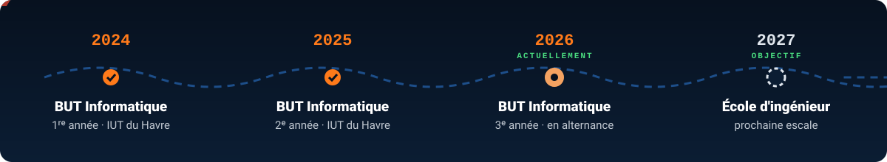

## 🛠️ Stack

  

<b>📦 Détail des compétences</b>

 

| Domaine | Technologies | Usage |
|:--|:--|:--|
| 🌐 **Web** | HTML · CSS · JavaScript · PHP | Développement web complet |
| 🐍 **Scripts** | Python · Flask | Scripts, automatisations et petites API |
| 🎮 **Temps réel** | TypeScript · React · Node.js (Fastify, WebSocket) | Applications web multijoueur |
| ☕ **Applications** | Java (Swing) · C | Programmation orientée objet, applications de bureau |
| 🗄️ **Données** | SQL | Gestion et modélisation de bases de données |
| 🐳 **Logistique** | Docker · Linux | Déploiement d'applications |
| 🧭 **Navigation** | Git · GitHub · VS Code | Versionnage et outillage au quotidien |

## 🚀 Projets

  <a href="https://github.com/NotSayk/goldmine"></a>
  <a href="https://github.com/NotSayk/MPM-Planner"></a>
  <a href="https://github.com/NotSayk/TonTube"></a>
  <a href="https://github.com/NotSayk/SchemaMemoire"></a>
  <a href="https://notsayk.github.io/portfolio"></a>
  <a href="https://notsayk.github.io/bio-link-page"></a>

<b>📸 Aperçu de Pépite Rush</b>

 

  

<b>🗂️ Autres projets</b>

 

| Projet | Description | Technos |
|:--|:--|:--|
| [Maroquinerie Thémis & Hélène](https://github.com/NotSayk/maroquinerie) | Site vitrine d'une boutique de maroquinerie avec catalogue | HTML · CSS · JavaScript |
| [Automatisation Vote PandakMC](https://github.com/NotSayk/automatisation-vote-pandakmc) | Extension Chrome qui automatise les votes pour un serveur Minecraft (code privé, politique de confidentialité publique) | JavaScript · Chrome Extensions |

## 🎮 MiniGames Sayk — mes jeux

  Mon studio de jeux en ligne : je les développe et les héberge moi-même sur <a href="https://sayk.fr"><b>sayk.fr</b></a>. 
  

  <a href="https://sayk.fr"></a>
  <a href="https://stickyclaude.sayk.fr"></a>

<b>📸 Aperçu de StickyClaude</b>

 

  

- 🧪 [**OpenClaude**](https://github.com/MiniGamesSayk/OpenClaude) — ma version d'[OpenFront.io](https://openfront.io), jeu de stratégie en temps réel (open source, AGPL v3)
- 🛠️ D'autres jeux sont en préparation…

## 📊 Statistiques

  

  

## 📓 Activité récente

<!--START_SECTION:activity-->
_Mise à jour en cours…_
<!--END_SECTION:activity-->

## 📡 Me contacter

  📧 <a href="mailto:samuel@ampeau.fr"><b>samuel@ampeau.fr</b></a> &nbsp;·&nbsp;
  💼 <a href="https://www.linkedin.com/in/samuel-ampeau-2b1a4a358/"><b>LinkedIn</b></a> &nbsp;·&nbsp;
  🔗 <a href="https://notsayk.github.io/bio-link-page"><b>Tous mes liens</b></a> &nbsp;·&nbsp;
  📍 Le Havre, France

  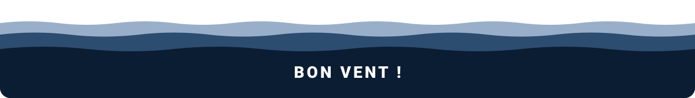

