<p align="center">
  
</p>

<p align="center">
  
  <a href="https://notsayk.github.io/portfolio"></a>
  <a href="https://www.linkedin.com/in/samuel-ampeau-2b1a4a358/"></a>
  <a href="mailto:samuel@ampeau.fr"></a>
</p>

<h3 align="center">💻 Étudiant en 2ᵉ année de BUT Informatique · IUT du Havre</h3>

<p align="center">
  Passionné par le <b>développement web</b> et la <b>création d'applications</b>, j'aime donner vie à des idées simples.<br/>
  J'explore différents environnements pour renforcer mes compétences — un conteneur à la fois. 🐳
</p>


## 🧾 Capitainerie — `docker-compose.yml`

```yaml
services:
  samuel:
    image: notsayk/developpeur:but-info-2
    container_name: samuel-ampeau
    restart: unless-stopped        # motivé et impliqué dans mes projets
    environment:
      PORT_ATTACHE: "Le Havre, France ⚓"
      FORMATION: "BUT Informatique — 2e année @ IUT du Havre"
      SPECIALITES: "développement web, applications, bases de données"
      TRAVAIL_EQUIPE: "projets académiques & associatifs 🤝"
      PASSION: "musique 🎸"
    volumes:
      - ./curiosite:/app/apprentissage
    networks:
      - open-source
```


## 🏗️ Terminal conteneurs — ma stack

<p align="center">
  
</p>

<details>
<summary><b>📦 Ouvrir le manifeste de cargaison</b></summary>
<br/>

| Conteneur | Contenu | Usage |
|:--|:--|:--|
| 🌐 **Web** | HTML · CSS · JavaScript · PHP | Développement web complet |
| 🐍 **Scripts** | Python · Flask | Scripts, automatisations et petites API |
| ☕ **Applications** | Java · C | Programmation orientée objet en Java |
| 🗄️ **Données** | SQL | Gestion et modélisation de bases de données |
| 🐳 **Logistique** | Docker · Linux | Déploiement d'applications |
| 🧭 **Navigation** | Git · GitHub · VS Code | Versionnage et outillage au quotidien |

</details>


## 🚢 Navires à quai — projets

<p align="center">
  <a href="https://github.com/NotSayk/portfolio"></a>
  <a href="https://github.com/NotSayk/bio-link-page"></a>
  <a href="https://github.com/NotSayk/NotSayk"></a>
  <a href="https://github.com/Akeush/TrueStrech"></a>
</p>

```console
$ docker ps --format "table {{.Names}}\t{{.Status}}\t{{.Ports}}"
NAMES            STATUS             PORTS
portfolio        Up (GitHub Pages)  notsayk.github.io/portfolio
bio-link-page    Up (GitHub Pages)  notsayk.github.io/bio-link-page
notsayk          Up (profil)        github.com/NotSayk
```


## 📊 Tableau de bord du port

<p align="center">
  
  
</p>

<p align="center">
  
</p>

<p align="center">
  
</p>


## 📓 Journal de bord

> Mis à jour automatiquement par une GitHub Action — les dernières escales de mon activité publique.

<!--START_SECTION:activity-->
<!--END_SECTION:activity-->


## 📡 Me contacter — canal VHF 16

<p align="center">
  📧 <a href="mailto:samuel@ampeau.fr"><b>samuel@ampeau.fr</b></a> &nbsp;·&nbsp;
  💼 <a href="https://www.linkedin.com/in/samuel-ampeau-2b1a4a358/"><b>LinkedIn</b></a> &nbsp;·&nbsp;
  🔗 <a href="https://notsayk.github.io/bio-link-page"><b>Tous mes liens</b></a> &nbsp;·&nbsp;
  📍 Le Havre, France
</p>

<p align="center">
  
</p>
